# Training 12 — Scenario Walkthroughs: Employee (with screenshots)

**Persona:** Avery Quinn, Senior Platform Engineer · *Employee Self Service*
**How to use this guide:** each scenario is a realistic situation, walked step by step with a screenshot of every state. Follow along live in the demo environment ([00-INDEX](00-INDEX.md) → Demo Environment). Companion concept course: [Training 01](01-end-user-employee.md).

---

## Scenario E1 — "It's Monday morning. What needs me?"

**Situation:** Avery logs in with no particular task in mind. Meridian's home page should tell her what matters *before* she looks for anything.

### Step 1 — Read the home page top-down

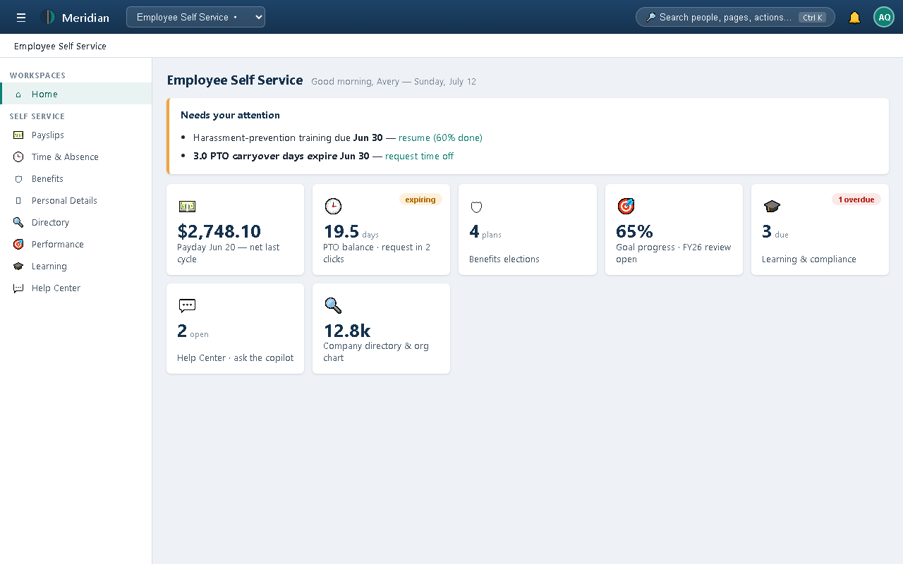

What to notice, in order:
1. **Header band (dark navy):** homepage selector (*Employee Self Service*), global search (`Ctrl K` hint), notification bell, avatar (AQ).
2. **"Needs your attention" strip** (amber left border — always read this first). Today it holds two deadline-driven items: *Harassment-prevention training due Jun 30 — resume (60% done)* and *3.0 PTO carryover days expire Jun 30 — request time off*. Both are **deep links** — one click lands you inside the task, not on a landing page.
3. **KPI tiles:** last net pay ($2,748.10, payday Jun 20), PTO balance (19.5 days, flagged **expiring**), benefits (4 plans), goal progress (65%, FY26 review open), learning (3 due, **1 overdue**), help cases, directory.

**The design rule:** if the attention strip is empty and no tile is flagged, nothing is waiting on you.

### Step 2 — Navigate anywhere with the command palette

Press **Ctrl+K** and type `pay`:

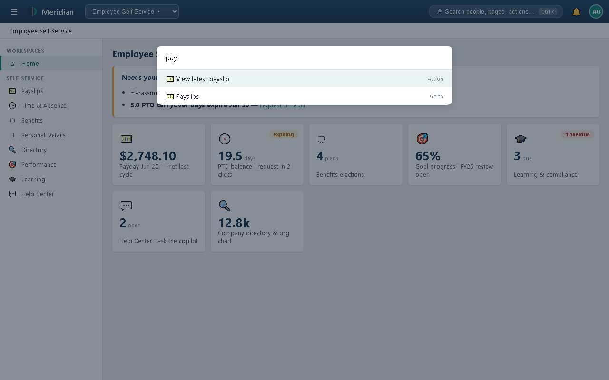

The palette matches **pages** (Payslips) and **actions** ("View latest payslip"). Arrow keys + Enter, or click. This is the fastest path to anything in Meridian — pages, quick actions ("Request time off"), even people ("Find Jordan Patel"). Escape closes it.

---

## Scenario E2 — "Why is my paycheck $96 lower this month?"

**Situation:** Avery notices her net pay dropped and wants an explanation without opening a ticket.

### Step 1 — Open Payslips

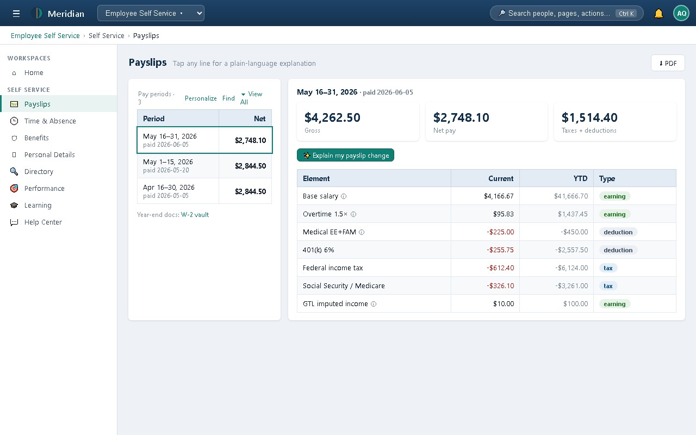

Left: pay periods with net amounts — May 16–31 shows **$2,748.10** vs $2,844.50 the period before. Right: the selected payslip with Gross / Net / Taxes+deductions KPIs and the element table. Every line with an ⓘ has a plain-language note.

### Step 2 — Click "✨ Explain my payslip change"

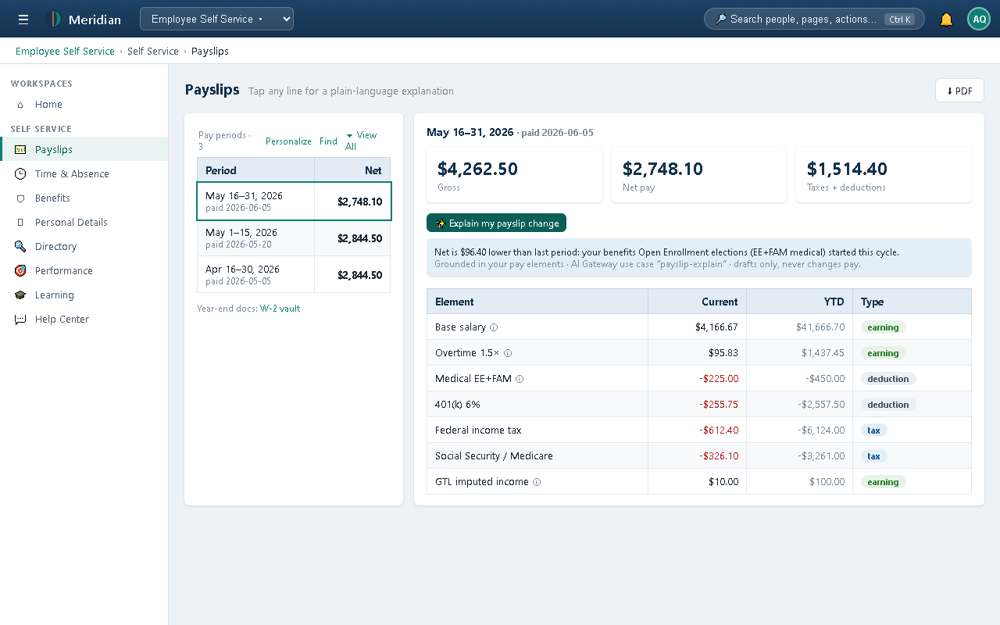

The answer appears inline: *"Net is $96.40 lower than last period: your benefits Open Enrollment elections (EE+FAM medical) started this cycle."*

Read the fine print under it: *"Grounded in your pay elements · AI Gateway use case 'payslip-explain' · drafts only, never changes pay."* — this is governed AI in action: the explanation is generated from **your own pay elements** through a **registered use case**, and it has no ability to modify anything.

### Step 3 — Drill into a single line

Click the **Overtime 1.5×** row:

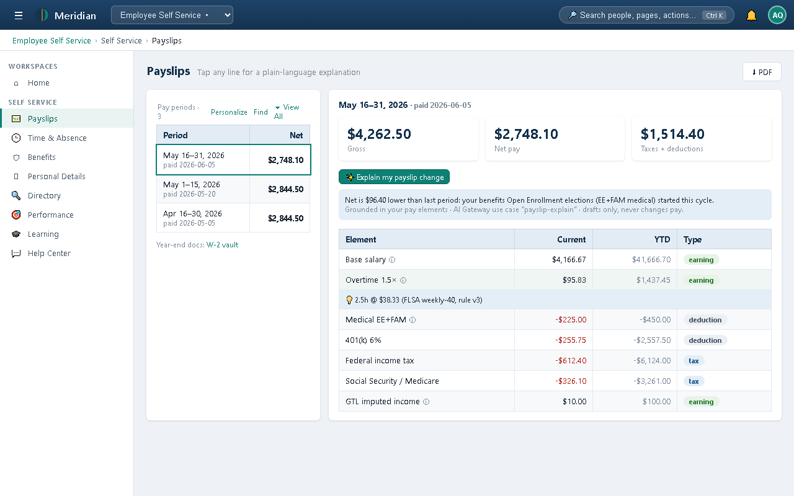

The note reveals the full math and its source: *"2.5h @ $38.33 (FLSA weekly-40, rule v3)"* — the exact hours, rate, and the **versioned rule** that computed it. If the OT rule changes next quarter, old payslips keep saying "v3"; new ones will say "v4". That version pin is your audit trail.

**Outcome:** question answered in three clicks, no case opened. This is the deflection model working as designed.

---

## Scenario E3 — "My carryover expires June 30 — I should use it."

**Situation:** the home page warned that 3.0 carryover days expire. Avery books time off before they're lost.

### Step 1 — Open Time & Absence

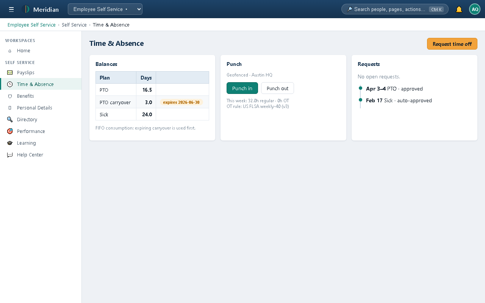

Three cards: **Balances** (PTO 16.5 · PTO carryover 3.0 with an amber *expires 2026-06-30* pill · Sick 24.0 — note the caption: *"FIFO consumption: expiring carryover is used first"*), **Punch** (geofenced, shows this week's hours and the OT rule version), **Requests** (currently none; history timeline below).

### Step 2 — Click "Request time off" and read the projection

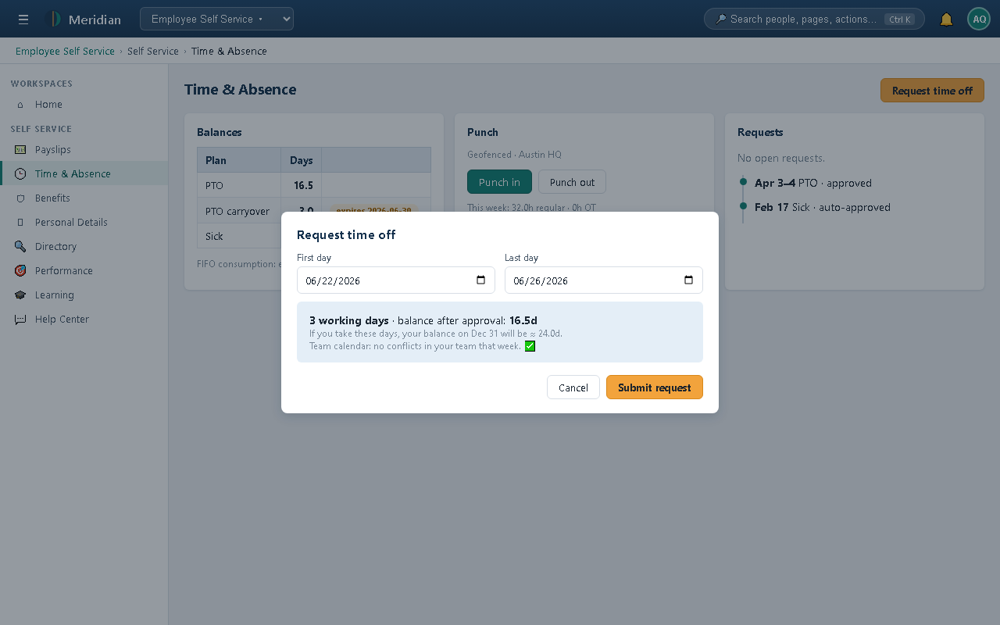

Before submitting anything, the modal already answers the three questions that used to require an HR email:
- **3 working days** — weekends excluded automatically
- **Balance after approval: 16.5d** — the expiring carryover is consumed first
- **Team calendar: no conflicts in your team that week ✅** — you won't collide with teammates
- **Year-end projection:** "your balance on Dec 31 will be ≈ 24.0d"

### Step 3 — Submit

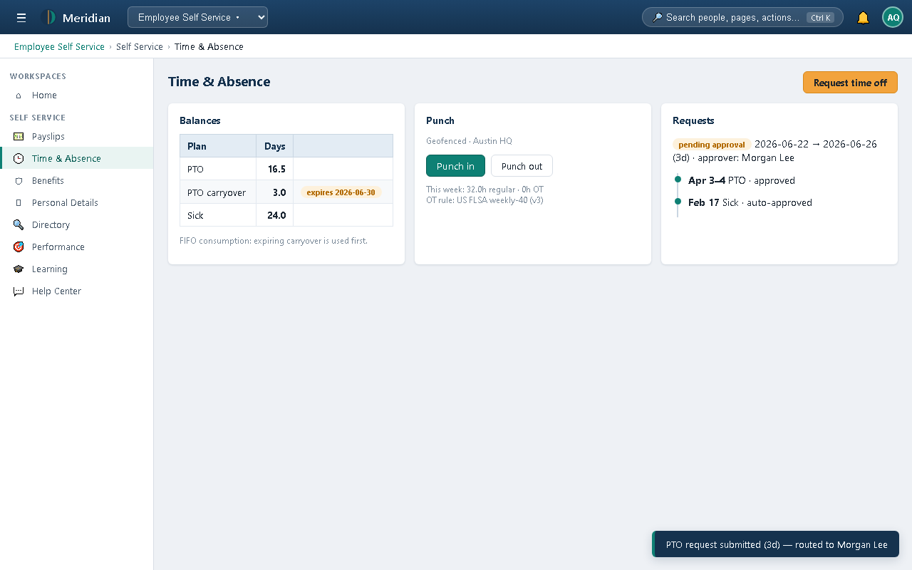

Two things changed: a toast confirms *"PTO request submitted (3d) — routed to Morgan Lee"*, and the **Requests card now shows the pending item** with its approver. The request is now sitting in Morgan's unified inbox (see [Training 13](13-scenarios-manager.md), Scenario M2 — it's the same demo item). You can cancel any time while it's pending.

---

## Scenario E4 — "What am I actually paying for benefits?"

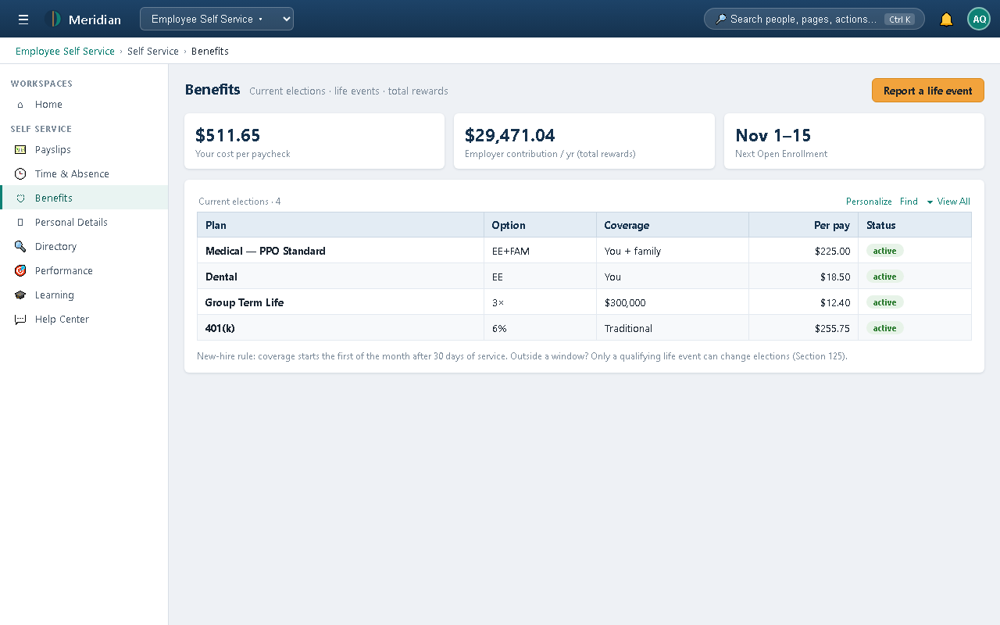

The three headline cards answer the usual questions instantly: **$511.65 your cost per paycheck**, **$29,471.04 employer contribution/year** (total rewards — what the company pays that you never see in net), and **Nov 1–15 next Open Enrollment**.

The elections grid shows each plan with option, coverage, per-pay cost, and status. Cross-check: the Medical $225.00 per-pay matches the payslip deduction in Scenario E2 — one number, consistent everywhere.

Note the footer rule: outside a window, **only a qualifying life event** changes elections (the amber "Report a life event" button starts that flow — marriage, birth, divorce, dependent aging out — with effective dates that follow the event, e.g. birth backdates coverage).

---

## Scenario E5 — "What was my job two years ago? And what's this transfer I heard about?"

**Situation:** Avery updates her mortgage paperwork (needs job history) and heard a transfer is coming.

### Step 1 — Open Personal Details

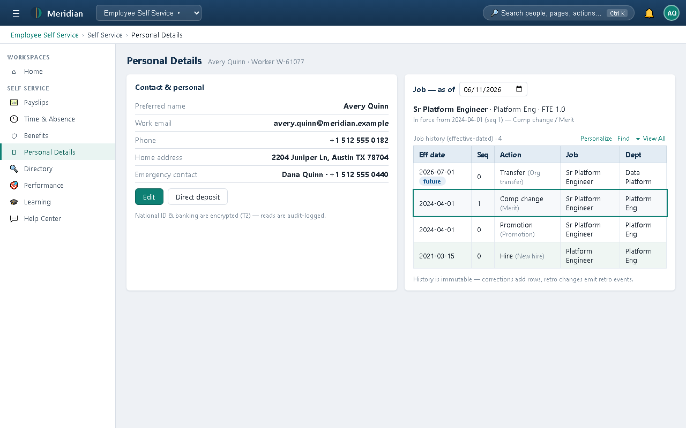

Left: contact details, Edit and **Direct deposit** buttons, and the privacy notice: *"National ID & banking are encrypted (T2) — reads are audit-logged."* Right: **Job — as of** with a date picker, and the full effective-dated history. Notice the 2024-04-01 date appears **twice** (seq 0 Promotion, seq 1 Comp change) — two changes on the same day, ordered by sequence — and the 2026-07-01 Transfer row carries a blue **future** pill.

### Step 2 — Time-travel with the as-of picker

Set the date to **2023-01-01**:

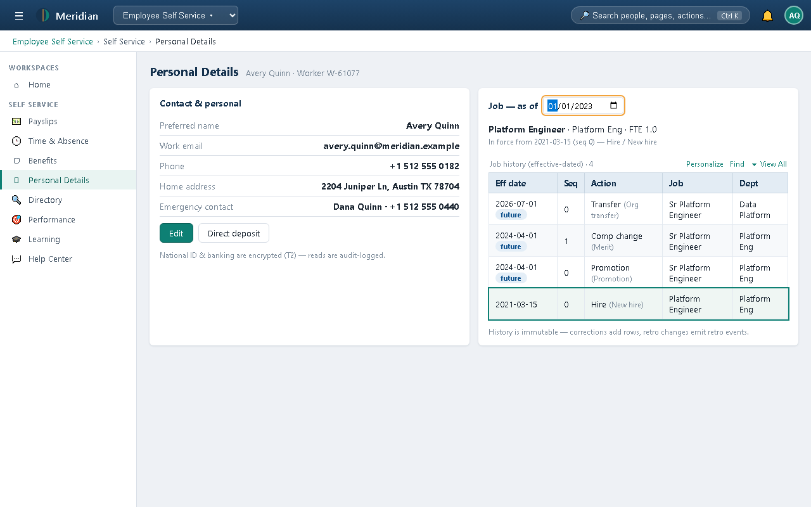

The "in force" panel now reads **Platform Engineer · Platform Eng · in force from 2021-03-15 (seq 0) — Hire / New hire**, and the highlight ring moves to the matching history row. That's the answer to "what was true then" — computed from history, not from anyone's memory.

Now set it to **2026-07-02** (after the future transfer):

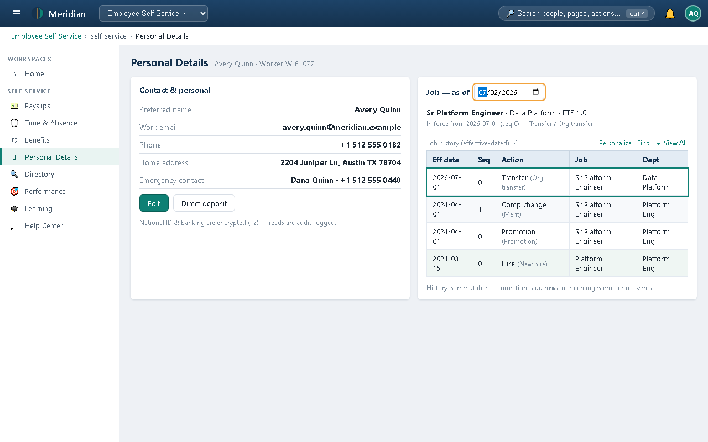

The in-force job flips to **Data Platform** — the approved future transfer, already visible, taking effect on its date and not a day earlier.

### Step 3 — Try to change bank details

Click **Direct deposit**:

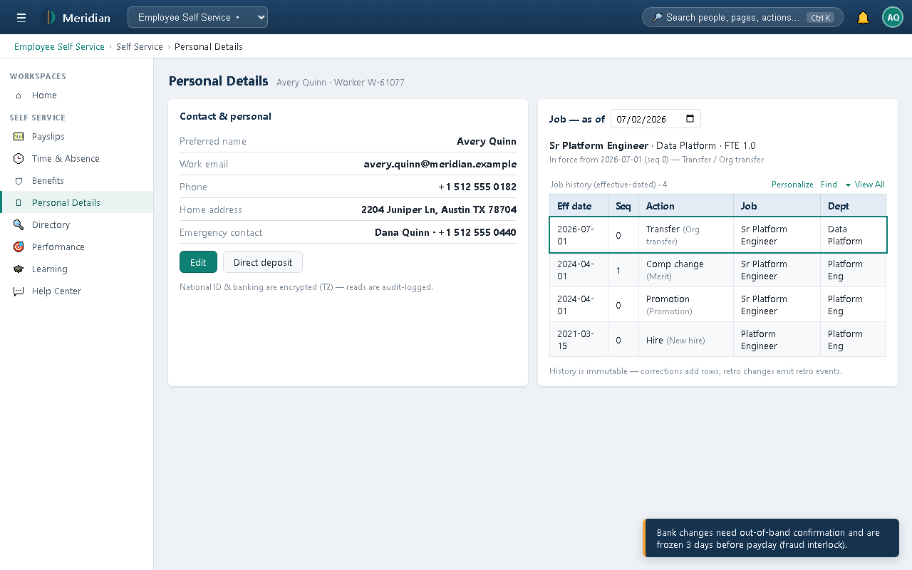

An amber toast explains the guard: *"Bank changes need out-of-band confirmation and are frozen 3 days before payday (fraud interlock)."* Payroll-diversion fraud targets exactly this transaction — the friction is deliberate and protects your salary.

---

## Scenario E6 — "Who is Jordan Patel and who does he report to?"

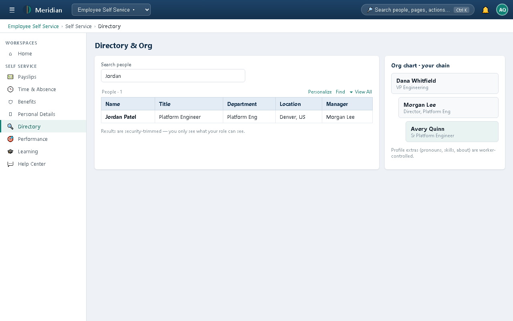

Search results show title, department, location, manager — and the right card shows **your own reporting chain** (Dana Whitfield → Morgan Lee → Avery Quinn). Two governance notes on this page: *results are security-trimmed* (you only see what your role can see), and *profile extras (pronouns, skills, about) are worker-controlled* — each person decides what beyond the basics is visible.

---

## Scenario E7 — "My review is open. Where do I stand?"

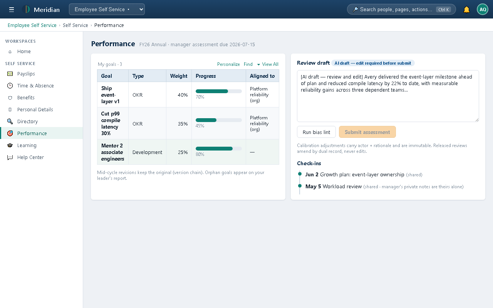

Left: **My goals** with type (OKR/Development), weight, progress, and org alignment; the caption notes *mid-cycle revisions keep the original (version chain)* — goals are history-preserving like everything else. Right: the **Review draft** panel demonstrates the AI guardrails end-to-end:
- The draft is visibly labeled **"AI draft — edit required before submit"**
- **Submit assessment is disabled** until you actually edit the text
- **Run bias lint** checks your wording deterministically before submission
- The caption states the calibration rules: adjustments carry actor + rationale and are immutable; released reviews amend by **dual record**, never edits

Check-ins below show the visibility model: shared entries, with *manager's private notes are theirs alone* (and yours are yours).

---

## Scenario E8 — "What training is due, and what happens if I ignore it?"

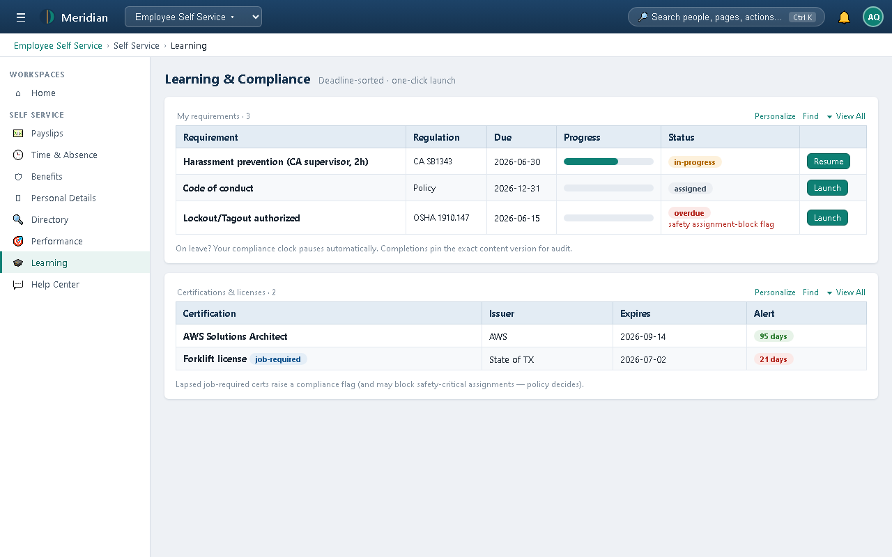

**My requirements** is deadline-sorted: the CA SB1343 harassment prevention course (due 06-30, in progress 60% — the same item the home page flagged, with a **Resume** button), Code of conduct (due year-end), and **Lockout/Tagout — overdue**, carrying a *safety assignment-block flag*: policy (not the Learning module itself) may block safety-critical assignments while it's lapsed.

**Certifications & licenses** tracks expiry with countdown pills (95 days / **21 days** amber). Note the captions — *"On leave? Your compliance clock pauses automatically"* and *"Completions pin the exact content version for audit"* — the two facts auditors always ask about.

---

## Scenario E9 — "I have a policy question." (copilot → human handoff)

### Step 1 — Ask the copilot

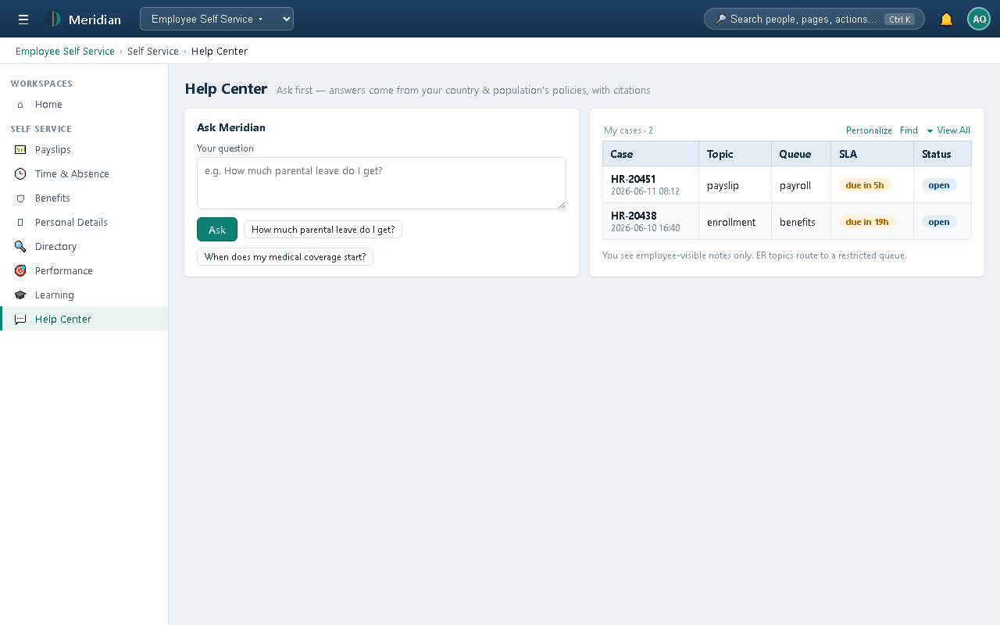

The Help Center leads with **Ask Meridian**, seeded question chips, and **My cases** on the right (with SLA and status pills — note *"You see employee-visible notes only"*).

### Step 2 — Read a grounded answer

Click a suggested question:

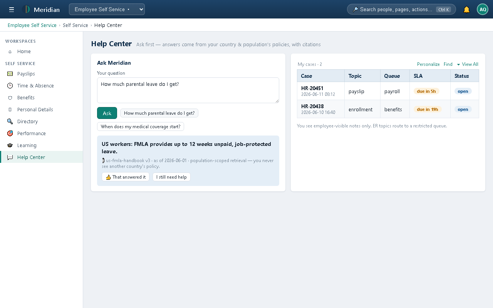

The answer arrives with a **📎 citation** to the exact policy document and the scoping statement: *"population-scoped retrieval — you never see another country's policy."* A German colleague asking the same question gets the German policy. The two buttons matter: **"👍 That answered it"** (counted as deflection *only if no case follows within 72h* — the honest metric) and **"I still need help."**

### Step 3 — Escalate to a human

Click **"I still need help"**:

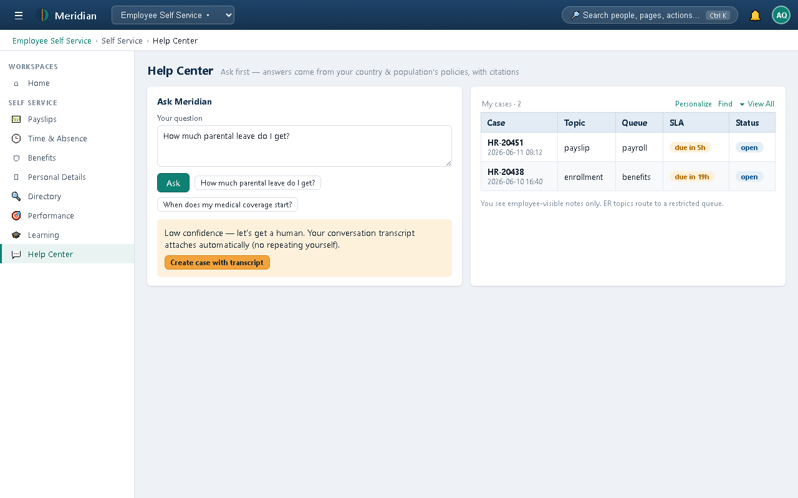

*"Low confidence — let's get a human. Your conversation transcript attaches automatically (no repeating yourself)."*

### Step 4 — Create the case

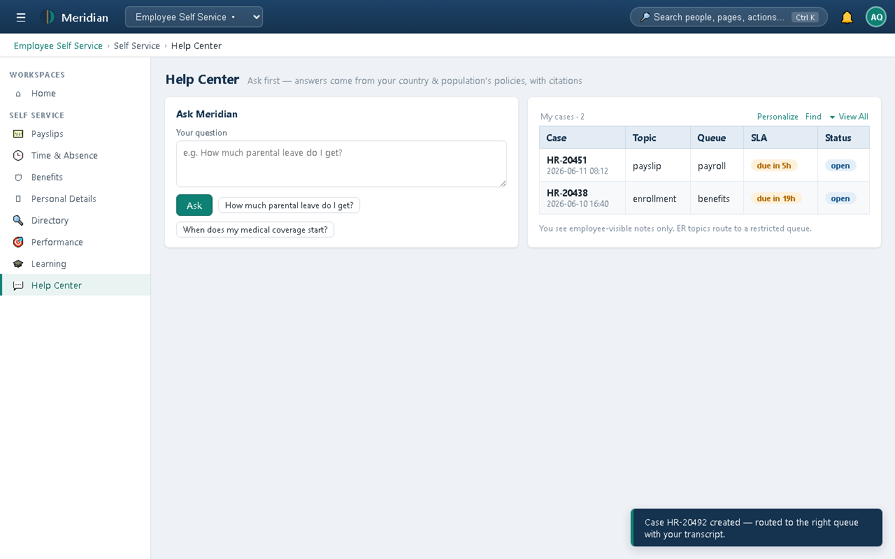

Toast: *"Case HR-20492 created — routed to the right queue with your transcript."* Routing is a decision table (category + population → queue + SLA); the agent receiving it reads your transcript first ([Training 09](09-helpdesk-agent.md) trains that side of the handoff).

---

## Recap — what these nine scenarios taught

| Scenario | Platform behavior demonstrated |
|---|---|
| E1 | Attention strip + tiles + palette = zero-hunting navigation |
| E2 | Self-explaining pay; versioned rules; governed read-only AI |
| E3 | Decision context (projection, conflicts) *before* submit; workflow routing |
| E4 | One consistent number across payslip and benefits; life-event windows |
| E5 | Effective dating, sequences, future dating, as-of queries, bank fraud interlock |
| E6 | Security-trimmed search; worker-controlled profile extras |
| E7 | Goal version chains; AI draft labeling + forced edit + bias lint |
| E8 | Compliance engine: escalation, policy-gated consequences, version-pinned evidence |
| E9 | Population-scoped copilot; honest deflection; transcript-attached handoff |
