# Training 13 — Scenario Walkthroughs: Manager (with screenshots)

**Persona:** Morgan Lee, Director of Platform Engineering · *Manager Self Service*
**Setup:** switch the homepage selector (top-left) to **Manager Self Service** — the left nav gains *Approvals*, *My Team*, *Comp Cycle*, *Recruiting*, and an *Administration* section with *Workforce Analytics*. Companion concept course: [Training 02](02-end-user-manager.md).

---

## Scenario M1 — "What's waiting on me as a manager?"

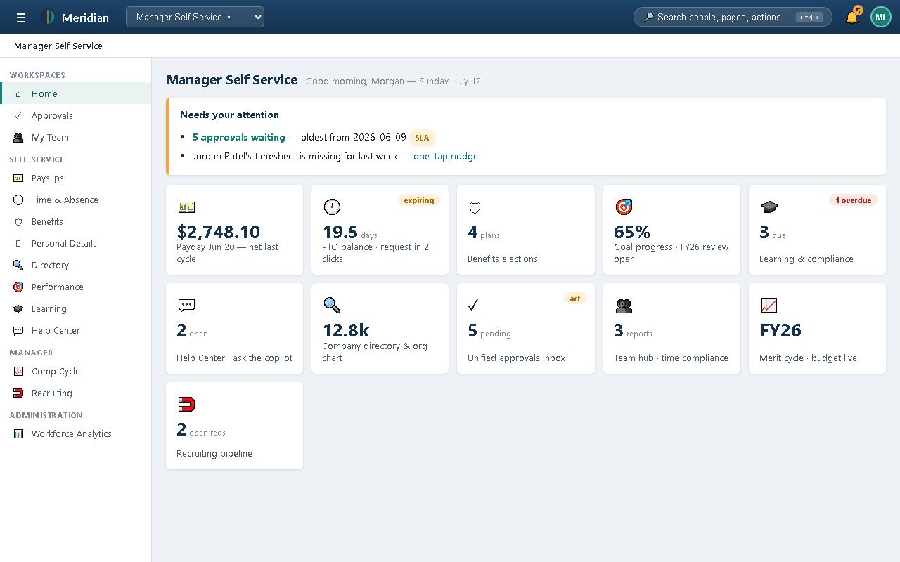

The same home page, re-shaped by persona. The attention strip now leads with **"5 approvals waiting — oldest from 2026-06-09"** with an SLA pill, plus *"Jordan Patel's timesheet is missing for last week — one-tap nudge."* New tiles: **Unified approvals inbox (5 pending, act)**, **Team hub**, **Merit cycle · budget live**, **Recruiting pipeline**. The notification bell now carries a badge (5).

---

## Scenario M2 — Clearing the inbox: bulk approval, the comp guardrail, and an individual decision

**Situation:** Monday triage. Five pending items of five different types. Morgan wants them gone in under two minutes — safely.

### Step 1 — Read the inbox as a table of decisions

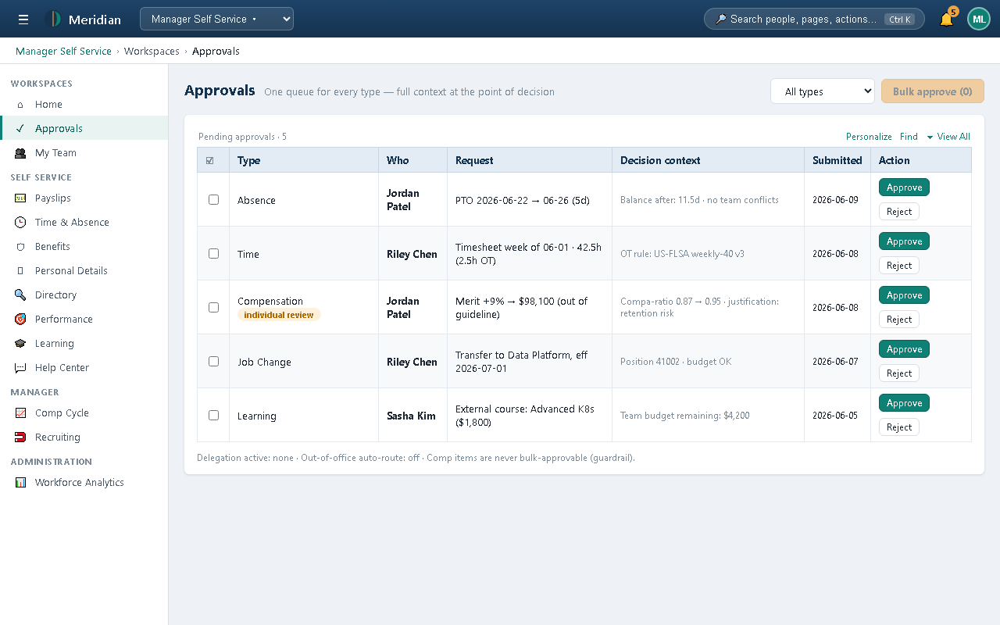

Every row carries its **decision context** inline so you rarely open anything:
- **Absence** · Jordan Patel · PTO Jun 22–26 (5d) → *"Balance after: 11.5d · no team conflicts"*
- **Time** · Riley Chen · 42.5h (2.5h OT) → *"OT rule: US-FLSA weekly-40 v3"*
- **Compensation** · Jordan Patel · Merit +9% → $98,100 → *"Compa-ratio 0.87 → 0.95 · justification: retention risk"* — and an amber **individual review** pill
- **Job Change** · Riley Chen · transfer eff 2026-07-01 → *"Position 41002 · budget OK"*
- **Learning** · Sasha Kim · $1,800 course → *"Team budget remaining: $4,200"*

Footer: *"Comp items are never bulk-approvable (guardrail)."* Let's prove it.

### Step 2 — Select everything (including comp, deliberately)

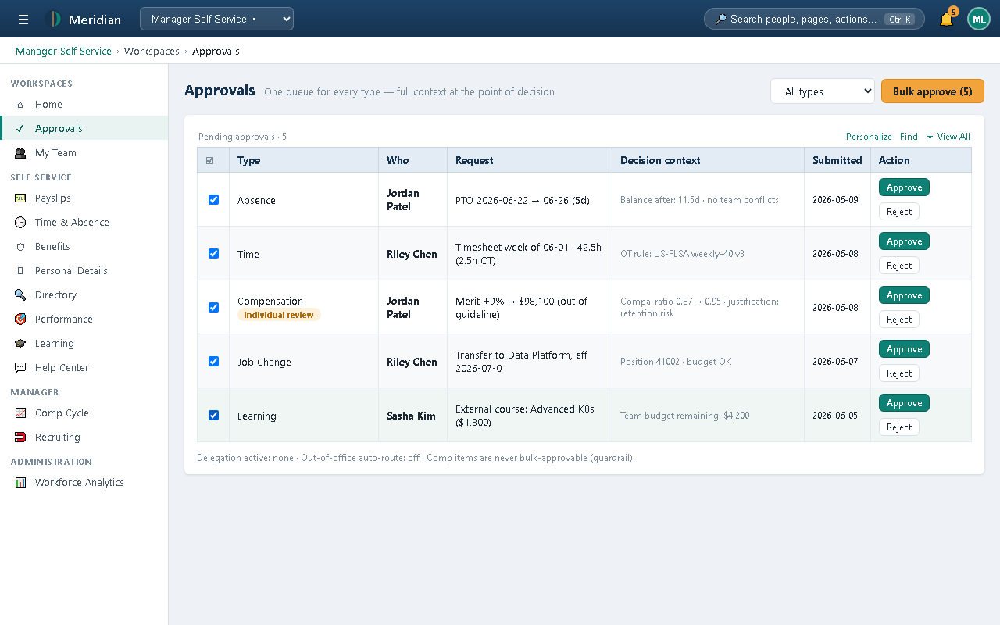

All five checkboxes ticked; the amber button reads **Bulk approve (5)**.

### Step 3 — The guardrail refuses the whole batch

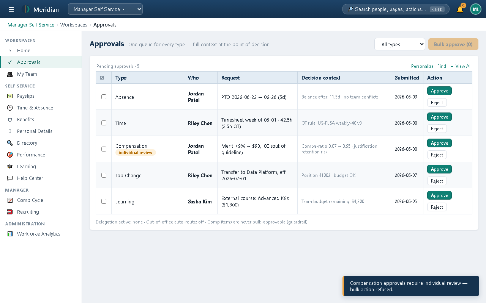

Toast (amber): *"Compensation approvals require individual review — bulk action refused."* Note what did **not** happen: the four routine items were not approved either. The system refuses the entire batch rather than silently splitting it — you always know exactly what a click did.

### Step 4 — Re-select without the comp item; bulk approve

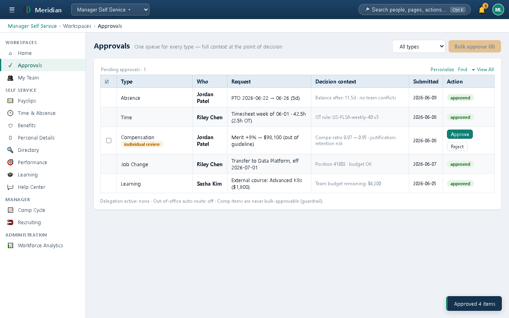

*"Approved 4 items"* — absence, time, job change, and learning now show green **approved** pills. One decision left.

### Step 5 — Decide the comp item on its own merits

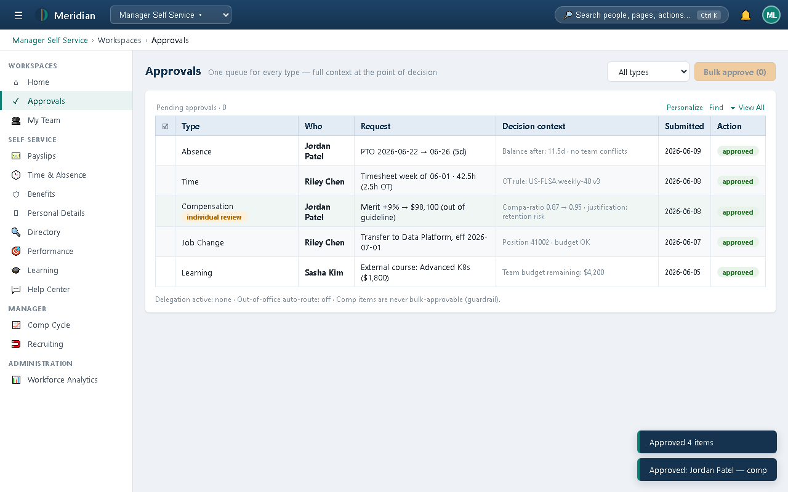

The row keeps its full context at the moment of decision: out-of-guideline flag, compa-ratio movement 0.87 → 0.95, the retention-risk justification. Approve (or reject — a rejection requires a reason the requester will read verbatim). The inbox is clear; total time ~90 seconds, and the one decision that deserved attention got it.

---

## Scenario M3 — "Someone's timesheet is missing before payroll cutoff."

### Step 1 — Open My Team

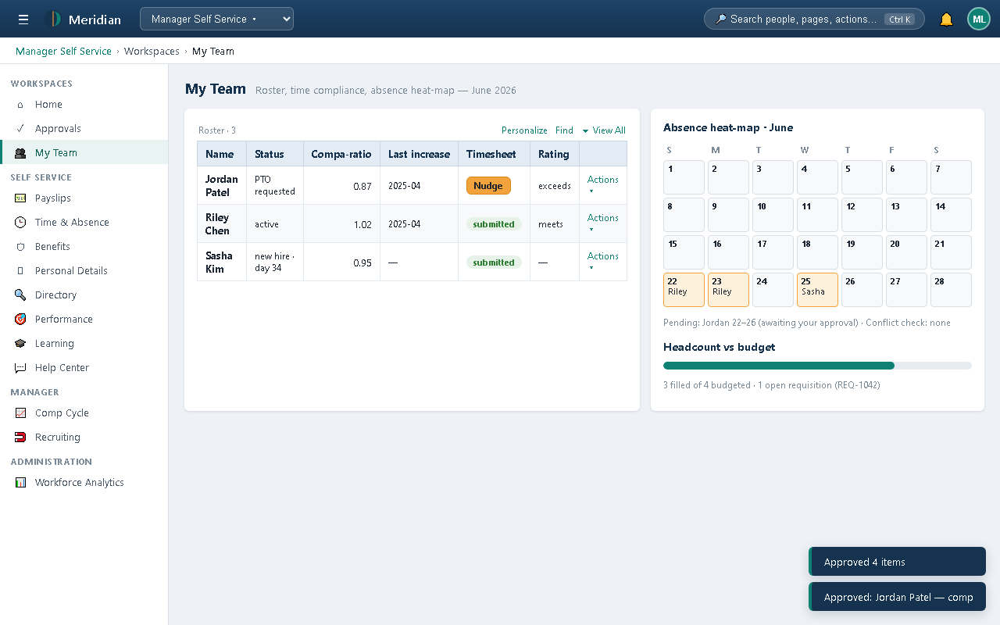

The roster shows per-person status, compa-ratio, last increase, **timesheet state** (Jordan: a **Nudge** button instead of a *submitted* pill), and an *Actions ▾* menu of guided transactions (transfer · promote · comp change · termination). Right: the June **absence heat-map** (Riley 22–23, Sasha 25), the note that Jordan's PTO 22–26 is *awaiting your approval*, and **headcount vs budget** (3 of 4 filled, 1 open req — REQ-1042, which appears again in Scenario M5).

### Step 2 — One-tap nudge

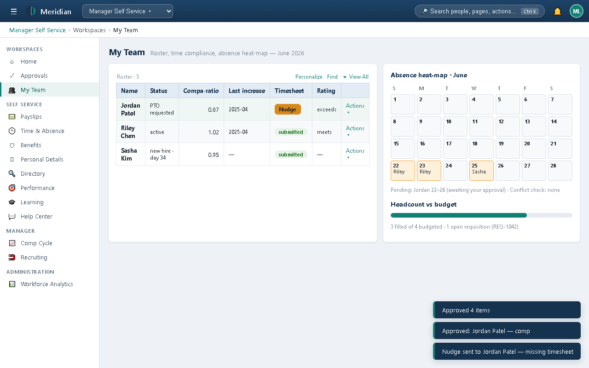

Toast: *"Nudge sent to Jordan Patel — missing timesheet."* No email composed, no chase thread — and the punch data behind timesheets was validated by the rules engine (the OT line you approved in M2 cited its rule version).

---

## Scenario M4 — Merit cycle: modeling within a live budget, going out of guideline deliberately

**Situation:** FY26 Merit is open. Morgan has an $18,000 pool and a retention case that justifies breaking guideline for Jordan.

### Step 1 — Read the worksheet before touching it

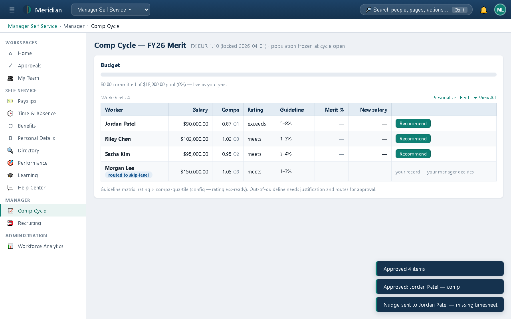

Top: the cycle facts — **FX EUR 1.10 (locked 2026-04-01) · population frozen at cycle open** — plus the **live budget bar** ($0 of $18,000 committed). Grid columns: salary, **compa-ratio with quartile**, rating, **guideline range** per person, merit %, projected new salary. Note the last row: **Morgan Lee — "routed to skip-level · your record — your manager decides"** — you cannot recommend for yourself; no Recommend button exists on your own line.

### Step 2 — Open Jordan's recommendation

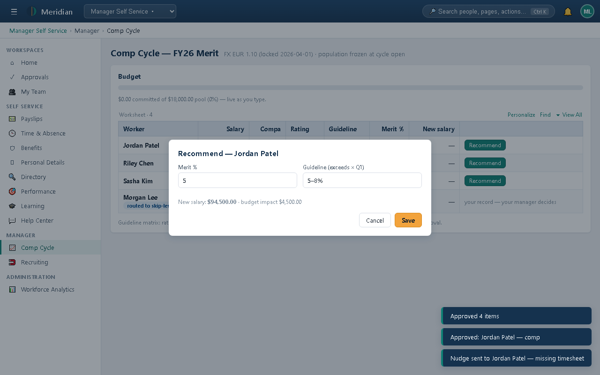

The modal shows his guideline (**5–8%**, from *exceeds × Q1* in the matrix) pre-filled and a live new-salary/budget-impact calculation.

### Step 3 — Type 12% and watch the mandatory justification appear

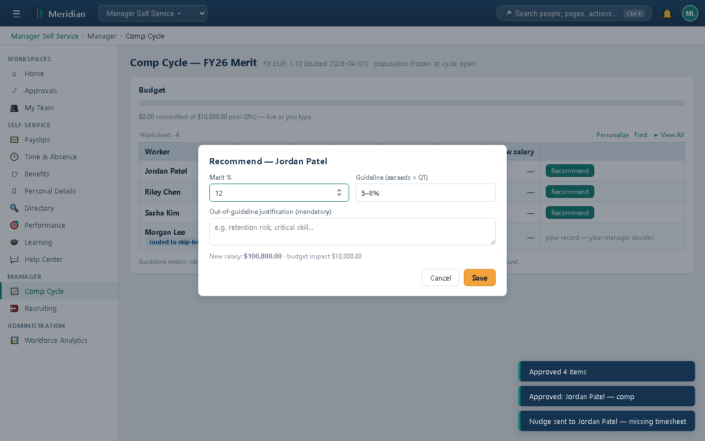

The moment the value leaves the 5–8% band, the **"Out-of-guideline justification (mandatory)"** textarea appears. New salary $100,800, budget impact $10,800 — computed live. Try saving without a justification: the save is refused with *"12% is outside guideline 5–8% — justification required."*

### Step 4 — Justify and save

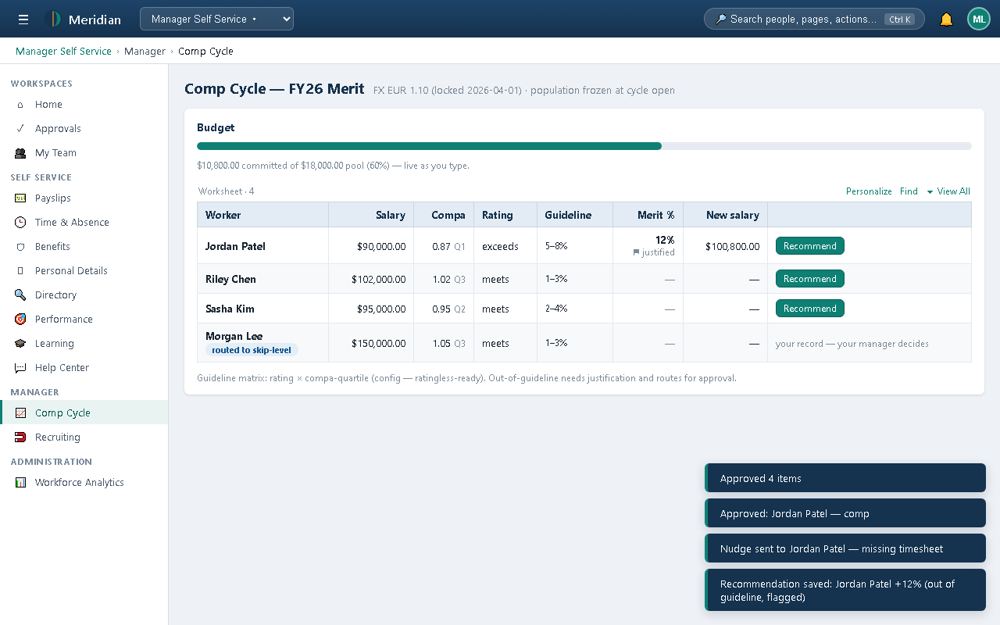

With the justification written (*"Retention risk — competing offer; critical platform knowledge"*), the save lands: the row now shows **12%** with a **⚑ justified** marker (hover shows the text), and the toast confirms *"(out of guideline, flagged)"* — the flag and text travel with the approval so the comp partner sees exactly what you wrote.

### Step 5 — Add an in-guideline entry and watch the budget bar

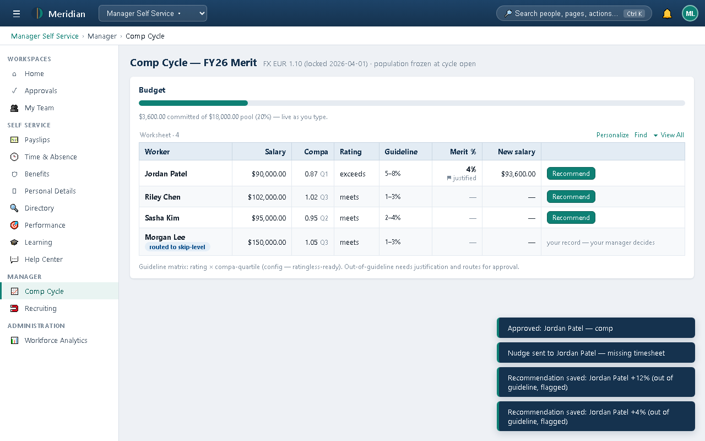

A 4% entry for the next worker commits instantly — the bar and the "$X committed of $18,000 (Y%)" line update **as you type**, turning amber past 85% and red at 100%. You can model freely; you just can't *submit* past the pool.

---

## Scenario M5 — Recruiting: advancing candidates with AI advice, and what happens when you try to let AI reject

### Step 1 — Read the pipeline

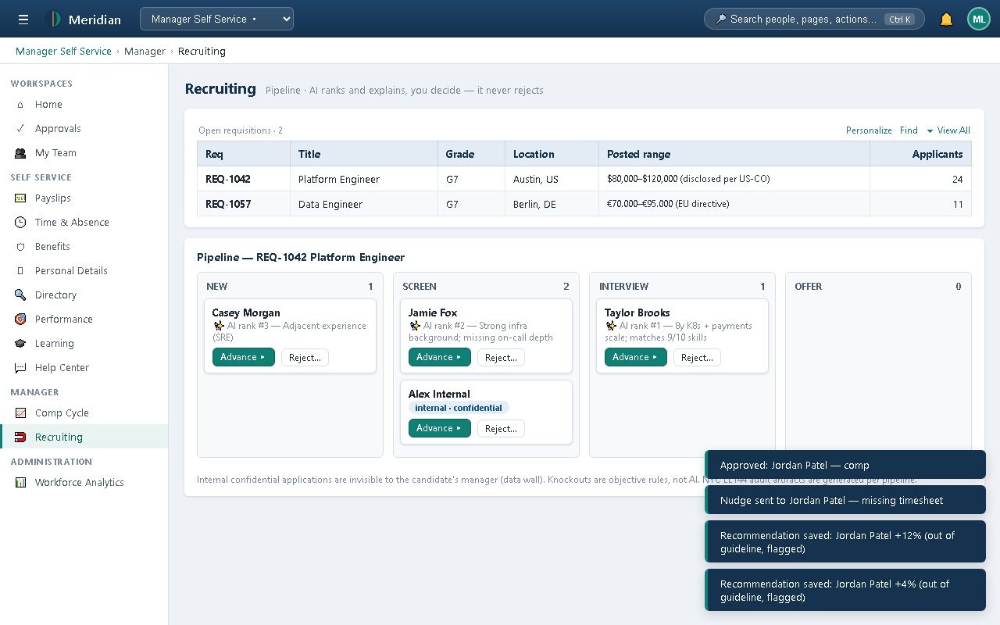

Requisitions on top (grade, location, **posted range** — pay transparency is configured per jurisdiction). Below, the REQ-1042 kanban: stage columns with candidate cards. Notice on the cards:
- **✨ AI rank #N with a readable reason** — advisory ordering, reasons on hover
- **internal · confidential** pill — an internal applicant whose own manager cannot see this application (data wall)
- Footer: *"Knockouts are objective rules, not AI. NYC LL144 audit artifacts are generated per pipeline."*

### Step 2 — Advance a candidate

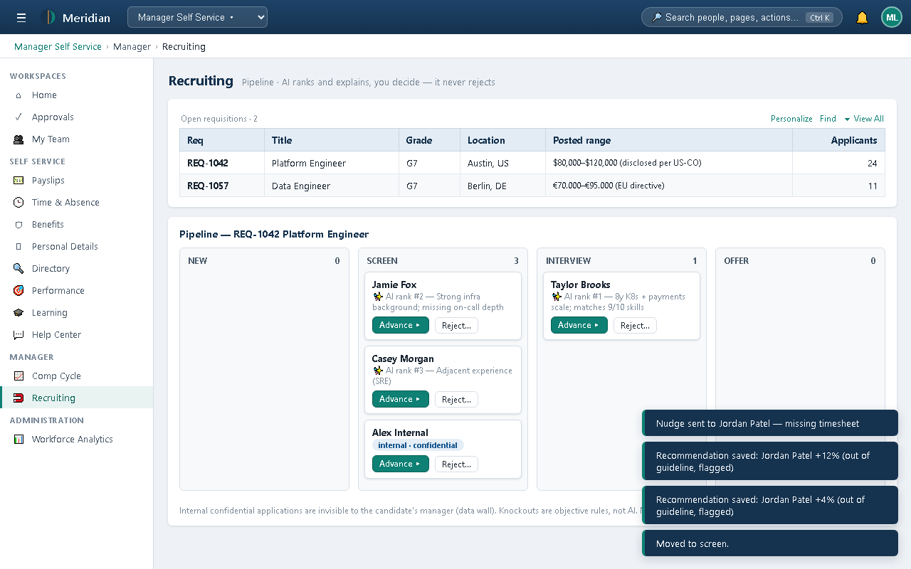

One click — *"Moved to screen."* The card moves columns; the stage flow is configuration (`stage_flows.yaml`), so stages can't be improvised per hiring manager.

### Step 3 — Try to reject

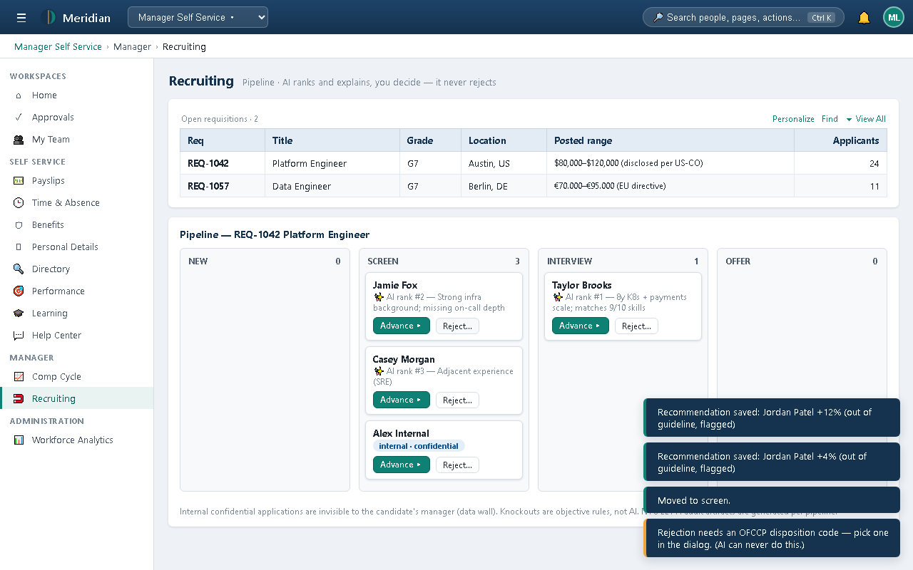

Clicking **Reject…** produces the guard, not a rejection: *"Rejection needs an OFCCP disposition code — pick one in the dialog. (AI can never do this.)"* Two rules in one toast: every rejection carries a disposition from the standard taxonomy (your audit defense), and there is **no code path by which the AI ranking can disposition anyone** — `reject()` refuses AI actors at the service layer.

---

## Recap — manager behaviors demonstrated

| Scenario | Platform behavior |
|---|---|
| M1 | Persona-shaped home: SLA-aware attention strip, action tiles |
| M2 | Context-at-decision inbox; bulk refusal on comp; individual comp decision |
| M3 | Team compliance one-taps; guided transactions; absence heat-map |
| M4 | Frozen population, locked FX, live budget, guideline matrix, mandatory justification, skip-level self-routing |
| M5 | Advisory-only AI ranking, confidential-internal data wall, disposition taxonomy, AI-cannot-reject |
