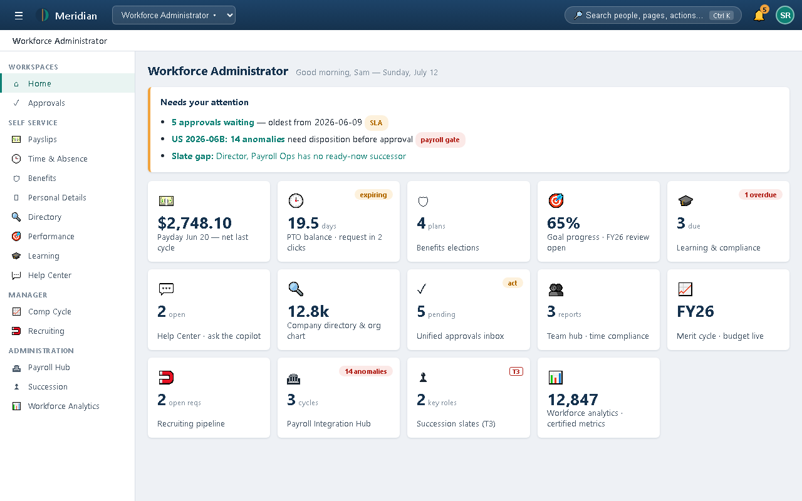
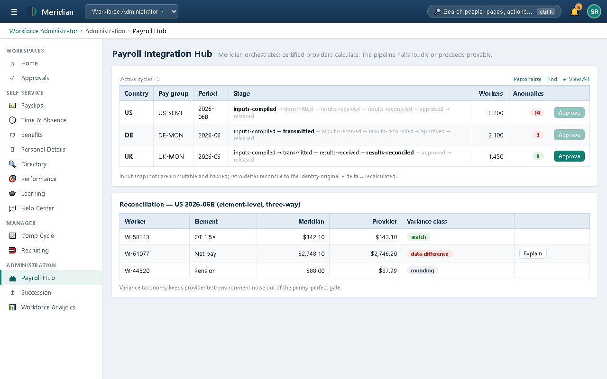
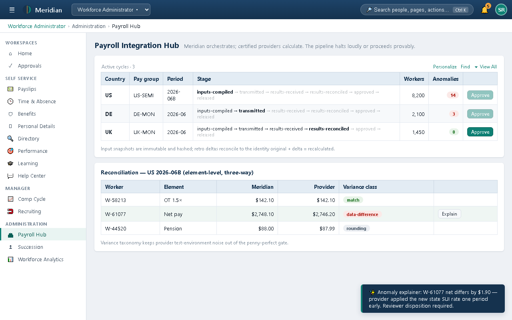
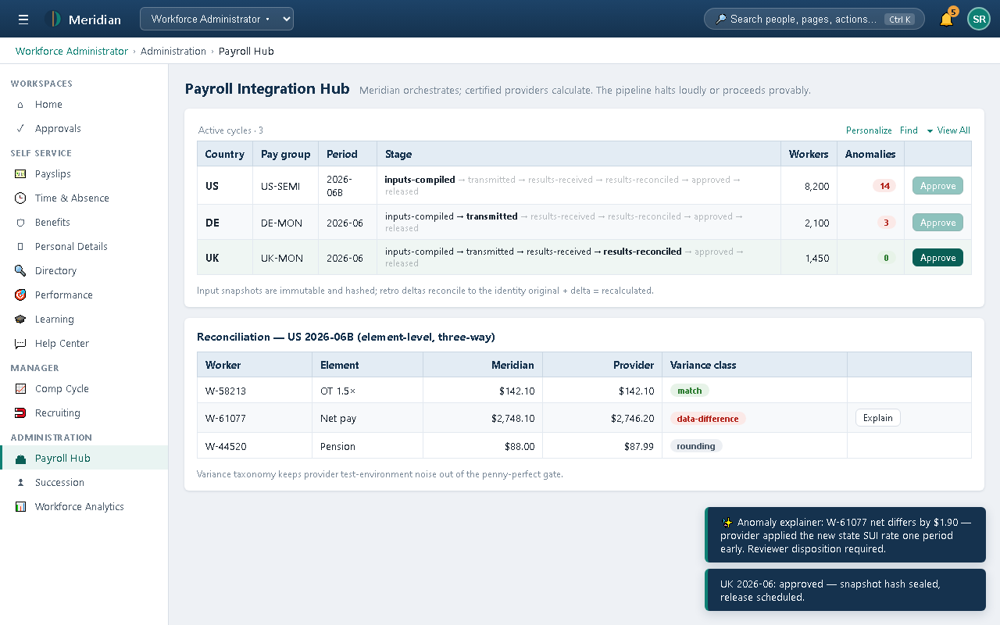
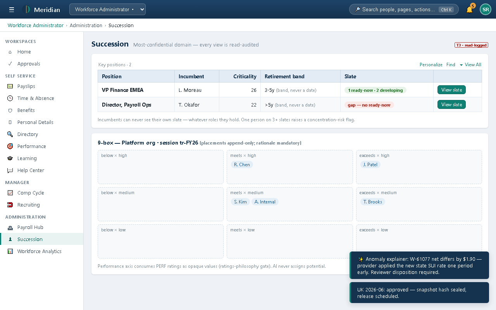
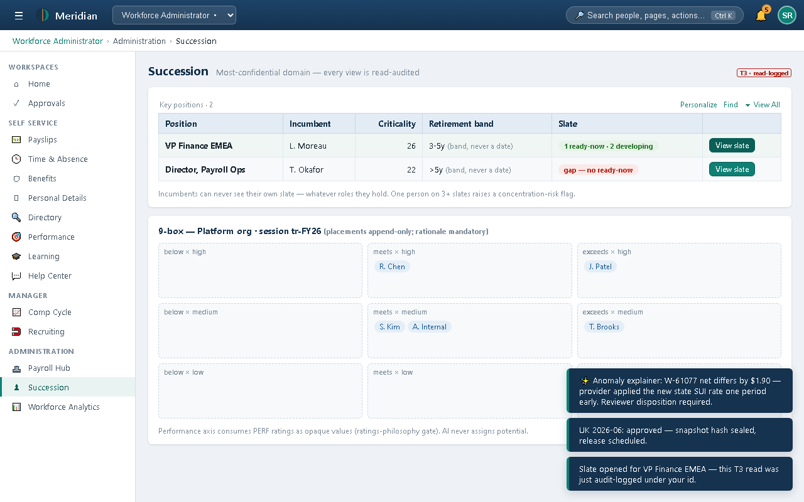
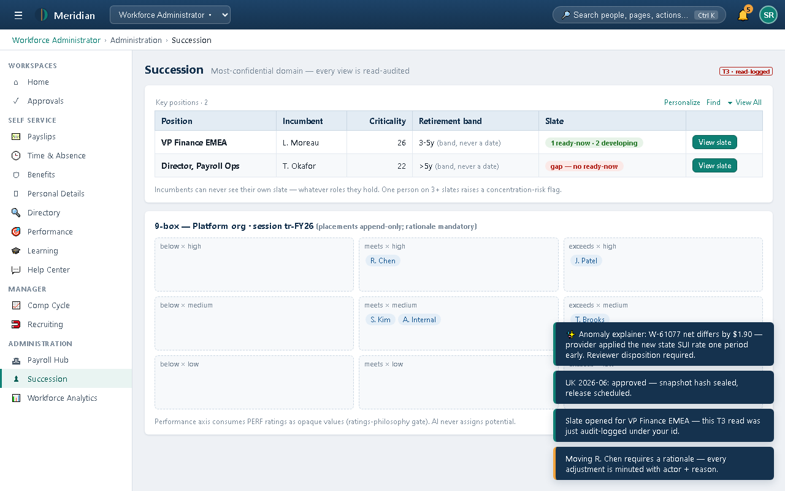
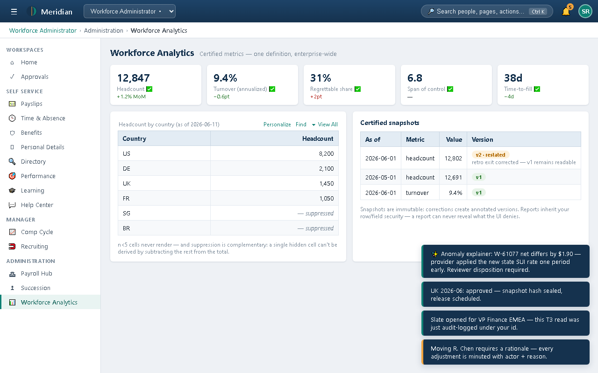
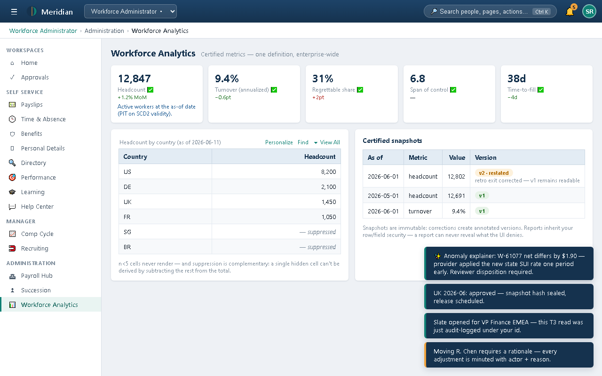

# Training 14 — Scenario Walkthroughs: Workforce Administrator (with screenshots)

**Persona:** Sam Rivera, HR Operations Lead · *Workforce Administrator*
**Setup:** switch the homepage selector to **Workforce Administrator** — the left nav gains the full *Administration* section: *Payroll Hub*, *Succession*, *Workforce Analytics*, alongside everything a manager sees. Companion concept course: [Training 03](03-super-user-hr-admin.md).

---

## Scenario H1 — "What does the platform need from HR today?"



The attention strip now carries **operational gates**, not personal to-dos:
- **"US 2026-06B: 14 anomalies need disposition before approval"** with a red **payroll gate** pill — payroll is blocked until a human dispositions these (Scenario H2).
- **"Slate gap: Director, Payroll Ops has no ready-now successor"** — a succession risk surfaced proactively (Scenario H3).

New admin tiles: **Payroll Integration Hub** (3 cycles, red *14 anomalies* flag), **Succession slates** (marked **T3** — the tier badge is on the tile itself, warning you before you even click), **Workforce analytics · certified metrics**.

---

## Scenario H2 — Payroll: anomalies gate the cycle, variances get explained, clean cycles get approved

**Situation:** three country cycles are in flight. The US cycle is blocked; Sam needs to understand why, disposition the blockers, and approve what's actually ready.

### Step 1 — Read the cycle board



Each cycle shows its position in the state machine — *inputs-compiled → transmitted → results-received → results-reconciled → approved → released* (the bold state is current):
- **US-SEMI 2026-06B** — 8,200 workers, **14 anomalies** (red) → its **Approve button is disabled**, tooltip: *"Anomalies must be dispositioned before approval"*
- **DE-MON 2026-06** — 2,100 workers, 3 anomalies → also gated
- **UK-MON 2026-06** — 1,450 workers, **0 anomalies**, results-reconciled → Approve is enabled

This is Invariant-level behavior made visible: **the pipeline halts loudly or proceeds provably — there is no force-past-the-gate button anywhere in the product.** Footer: *"Input snapshots are immutable and hashed; retro deltas reconcile to the identity original + delta = recalculated."*

### Step 2 — Understand a variance before dispositioning it

The reconciliation panel shows the element-level three-way compare with a **variance taxonomy**: `match` (green), `rounding` (grey — tolerated), `data-difference` (red — needs a human), `env-difference` (amber — provider test-environment noise, kept out of the penny-perfect gate). Click **Explain** on the red one:



*"✨ Anomaly explainer: W-61077 net differs by $1.90 — provider applied the new state SUI rate one period early. Reviewer disposition required."*

The AI **explains** the variance (grounded in the reconciliation data); the **disposition stays yours**. Note it names the likely cause *and* still demands the human decision — that division of labor is the whole AI-governance model in one toast.

### Step 3 — Approve the clean cycle



UK (0 anomalies) approves: *"UK 2026-06: approved — snapshot hash sealed, release scheduled."* The input snapshot is hashed and immutable at approval — what was approved is cryptographically what gets released, and any later change arrives as a retro delta that must reconcile to the identity.

---

## Scenario H3 — Succession: the most confidential screen in the product

**Situation:** the home page flagged a slate gap. Succession data is T3 — this scenario is as much about *how the data protects itself* as about the gap.

### Step 1 — Read the key-positions board



Before anything else, see the page header: **"T3 · read-logged"** and the subtitle *"Most-confidential domain — every view is read-audited."* You are being told, honestly, that opening this page left a trace.

The grid shows per key position: incumbent, criticality score, **retirement band — "(band, never a date)"** (the system will not let anyone store a retirement *date*, by design), and slate health — **"gap — no ready-now"** in red for Director Payroll Ops vs green *"2 ready-now · 1 developing"* elsewhere. Footer rules: *"Incumbents can never see their own slate — whatever roles they hold. One person on 3+ slates raises a concentration-risk flag."*

### Step 2 — Open a slate and watch the audit acknowledge you



Toast: *"Slate opened for VP Engineering — this T3 read was just audit-logged under your id."* Not a warning — a receipt. Every T3 read writes an audit event with your identity; if a succession leak is ever investigated, the access trail already exists.

### Step 3 — Try to move someone on the 9-box



The 9-box grid (performance × potential) shows placement chips. Clicking one: *"Moving Riley Chen requires a rationale — every adjustment is minuted with actor + reason."* Placements are **append-only** — a re-placement is a new lineage row, the session minutes show the full history, and nothing is ever edited in place. Footer: *"Performance axis consumes PERF ratings as opaque values (ratings-philosophy gate). AI never assigns potential."*

---

## Scenario H4 — Analytics: certified numbers, honest suppression

**Situation:** the CHRO asks "what's our headcount, and why did last month's number change?"

### Step 1 — Read the analytics page



Three things on one screen answer the whole conversation:
1. **Certified metric KPIs** (each with a ✅) — headcount, turnover, span: *one definition, enterprise-wide*, from the governed metric registry.
2. **Headcount by country** with one row reading **"— suppressed"**: cells below n=5 never render, and suppression is **complementary** — a second cell is hidden so the small one can't be recovered by subtracting the rest from the total. Even admins don't bypass this.
3. **Certified snapshots**: the 2026-06-01 headcount shows **v2 · restated** — *"retro exit corrected — v1 remains readable."* The board saw v1; v1 still exists; v2 documents the correction. Nothing was overwritten.

### Step 2 — Click a metric for its definition



Clicking a KPI reveals its registry definition inline — the precise formula (e.g., what counts as headcount: FTE vs point-in-time, contractor inclusion) so two executives can never quote two "headcounts" computed differently.

Footer to quote in the CHRO meeting: *"Reports inherit your row/field security — a report can never reveal what the UI denies."*

---

## Recap — administrator behaviors demonstrated

| Scenario | Platform behavior |
|---|---|
| H1 | Operational gates surfaced on home; T3 labeling before you click |
| H2 | Anomaly-gated approvals (no force path), variance taxonomy, AI explains / human dispositions, sealed snapshots |
| H3 | T3 read-audit receipts, incumbent self-block, bands never dates, append-only 9-box with mandatory rationale |
| H4 | Certified metrics with one definition, complementary suppression, restatement-by-version |

## Regenerating these screenshots

All images in `Training/screenshots/` are generated from the live demo UI by `Training/screenshots/_capture.mjs`. To refresh after a UI change:

```powershell
cd UI
npm install --no-save playwright ; npx playwright install chromium   # once
npm run dev                                                          # keep running
node ..\Training\screenshots\_capture.mjs                            # writes all PNGs
```
